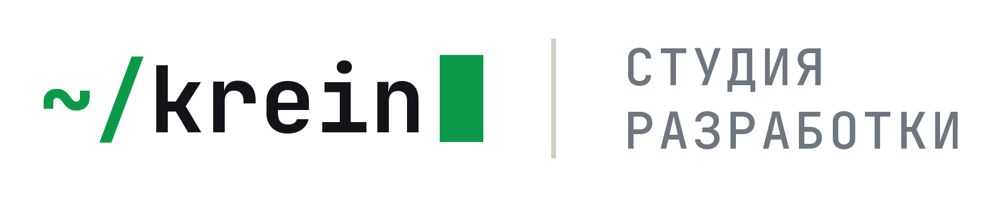
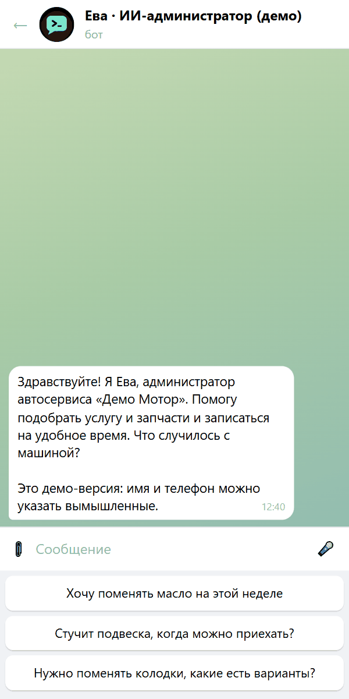
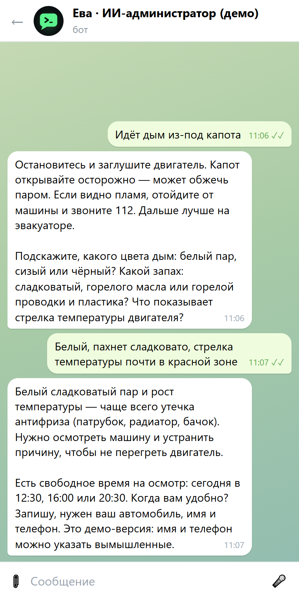
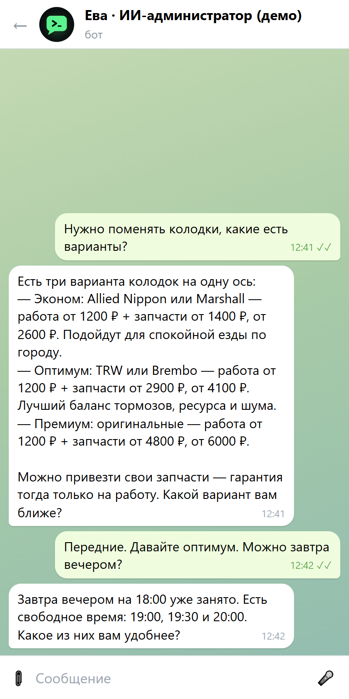
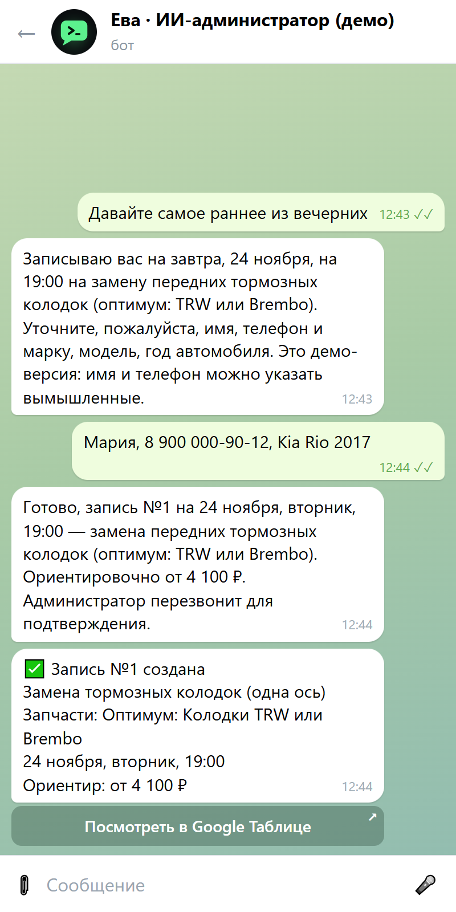
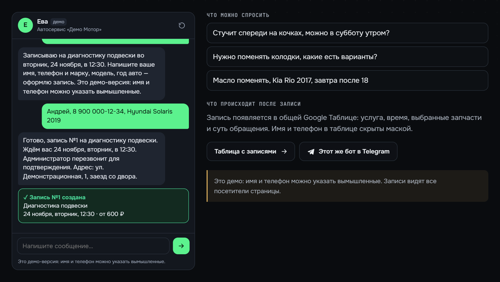
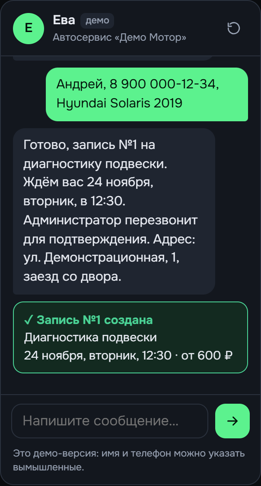
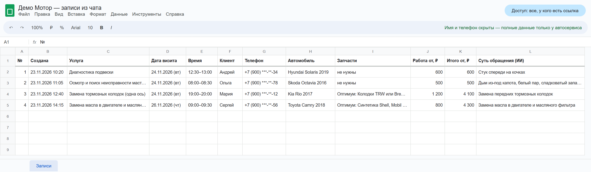

<div align="center">

<a href="https://kreinstudio.ru/">
  <picture>
    <source media="(prefers-color-scheme: dark)" srcset="assets/brand/logo-dark@2x.png">
    
  </picture>
</a>

<br>

# ИИ-администратор для записи клиентов

**Отвечает клиентам на сайте и в Telegram круглосуточно: разбирается, что случилось, подбирает услугу и запчасти, находит свободное время и записывает. Каждая запись сразу появляется в Google Таблице.**

<br>

<a href="https://t.me/krein_ai_booking_bot"></a>
<a href="https://kreinstudio.ru/uslugi/ii-assistent/zapis-klientov/#demo"></a>

### 👉 [@krein_ai_booking_bot](https://t.me/krein_ai_booking_bot) — запишитесь в демо-автосервис за 2 минуты

Имя и телефон можно вымышленные · регистрация не нужна · запись появится в [публичной таблице](https://docs.google.com/spreadsheets/d/1-MfnfIIxTNwmnk-_8eaBYkFDcnz_LuDrT48dH1TVMu8/edit?usp=sharing#gid=7845231)

<br>



[](https://github.com/krein15/ai-booking-bot/actions/workflows/tests.yml)

</div>

---

## Какую проблему решает

Клиенты пишут вечером, в выходные и в обед — когда администратор занят или его нет. Каждый вопрос без ответа — клиент, который записался к конкурентам. А те, кому ответили, описывают проблему своими словами, и администратор не знает, на какую услугу их записать и сколько это будет стоить.

| Было | С ботом |
|---|---|
| Ответ — когда освободится администратор, ночью тишина | Ответ за несколько секунд в любое время |
| «Что-то стучит» — непонятно, на что записывать | Бот задаёт уточняющие вопросы и подбирает услугу |
| «Сколько стоит?» — «Зависит от запчастей» | Три варианта запчастей с ценами: эконом, оптимум, премиум |
| Запись в тетрадке или в голове администратора | Каждая запись — в базе и в Google Таблице |
| Накладки по времени, двойные записи | Свободное время считается по расписанию постов: занятое бот не предложит |
| Мастеру пересказывают, что сказал клиент | В записи — суть обращения, автомобиль и выбранные запчасти |

## Попробуйте за 2 минуты

1. Откройте **[@krein_ai_booking_bot](https://t.me/krein_ai_booking_bot)** и нажмите «Запустить» — или напишите в чат на [странице демо](https://kreinstudio.ru/uslugi/ii-assistent/zapis-klientov/#demo).
2. Напишите как обычный клиент: «стучит спереди на кочках», «идёт дым из-под капота», «нужно поменять колодки».
3. Выберите время и вариант запчастей, оставьте любое имя и номер.
4. Нажмите «Посмотреть в Google Таблице» — ваша запись уже там, имя и телефон скрыты.

> ⚠️ Это демо вымышленного автосервиса «Демо Мотор»: никто не перезвонит и не приедет. Начать диалог заново — `/new`.

## Как это выглядит

| Диагностика | Варианты запчастей | Запись |
|:---:|:---:|:---:|
| <br>Сначала безопасность, потом причина | <br>Эконом, оптимум, премиум — с ценами | <br>Карточка записи и ссылка на таблицу |

<p align="center">
  
  <br>
  Тот же бот на сайте — чат встраивается одной строкой и подстраивается под дизайн
</p>

<p align="center"><br>Google Таблица: каждая запись с услугой, временем, автомобилем, запчастями, суммой и сутью обращения</p>

<sub>Картинки собраны из настоящих ответов бота: диалоги прогоняются через GigaChat (<code>docs/dialogs.json</code>), переписка рисуется в стиле Telegram, а чат на сайте снимается настоящим виджетом (<code>scripts/render_screenshots.py</code>). Клиенты на них вымышленные.</sub>

## Возможности

**Для клиента**
- Пишет как привык: «стучит», «дымит», «горит лампочка» — бот поймёт и задаст уточняющие вопросы
- Если ехать опасно (тормоза, перегрев, запах бензина), бот сразу так и скажет и посоветует эвакуатор
- Варианты запчастей с ценами: эконом, оптимум, премиум или свои
- Свободное время на нужный день, а если занято — ближайшие окна рядом
- Запись за пару сообщений и карточка с итогом: услуга, время, ориентир по цене
- Ответы на частые вопросы: адрес, оплата, гарантия, эвакуатор, скидки

**Для владельца**
- Каждая запись — в Google Таблице: услуга, время, автомобиль, запчасти, сумма и суть обращения, которую ИИ записал своими словами
- Полные имя и телефон — в базе на вашем сервере; в публичной таблице демо они скрыты
- Один бот сразу на сайте и в Telegram
- Услуги, цены, часы работы, число постов и запчасти — в одном файле настроек

**Бот сам**
- Считает свободное время по расписанию: модель не может придумать окно или записать на занятое время
- Перепроверяет ответ модели перед отправкой: выдуманное время, обещание «сейчас посмотрю» без проверки, запись без выбранных запчастей — на переписывание
- Отвечает только по теме автосервиса
- Держит нагрузку: лимиты на сообщения и записи с одного адреса, очередь к модели

## Разбирается в машинах

У бота есть справочник неисправностей по 10 системам автомобиля: тормоза, подвеска, двигатель, охлаждение, утечки, рулевое, сцепление, электрика, кондиционер, шины. Справочник составлен вместе с практикующим автомехаником, поэтому бот рассуждает как мастер на приёмке:

- **сначала безопасность** — «остановитесь, заглушите двигатель, дальше на эвакуаторе»;
- **один точный вопрос**, который отделяет причины: цвет дыма, где капает, когда свистит;
- **без лишних услуг** — компьютерную диагностику не предлагает там, где мастер всё увидит глазами.

Например: белый пар со сладким запахом и стрелка температуры у красной зоны — это антифриз, а не масло; свист под капотом на холодную — приводной ремень, а не ГРМ.

## Адаптация под ваш бизнес

Автосервис — только пример. Бот настраивается под другую нишу без переделки кода — это один файл настроек: салон красоты, барбершоп, клиника, стоматология, автомойка, шиномонтаж, ремонт техники.
- услуги, длительность и цены; мастера, кресла или посты; часы работы;
- вопросы, которые задаёт ваш лучший администратор;
- поля записи (автомобиль, мастер, питомец) и колонки таблицы;
- имя бота, приветствие и стиль общения.

**Доработки под задачи бизнеса:**
- 🗓 **Синхронизация с расписанием** — YCLIENTS, Google Календарь, amoCRM, Bitrix24
- 🔔 **Напоминания** — за день до визита, с подтверждением и переносом записи
- 📣 **Уведомления администратору** о каждой новой записи в Telegram
- 💬 **Другие каналы** — VK, WhatsApp, Авито
- 🧠 **Другая модель** — DeepSeek, YandexGPT: логика записи не меняется

Установка на ваш сервер или размещение у меня с сопровождением.

## Безопасность и персональные данные

- Модель — российский GigaChat от Сбера
- В публичной таблице демо имя и телефон скрыты маской; полные данные — только в базе на вашем сервере
- IP посетителей хранится только в виде хэша
- Ключи и токены лежат только на сервере, в коде их нет
- Защита от спама и накруток: лимиты на сообщения, диалоги и записи с одного адреса, дневной лимит модели
- Каждое изменение бота проверяют больше сотни автотестов

## Автор

**Бондаренко Николай** — ИИ-боты, Telegram-боты и автоматизация на Python для бизнеса. Нужен такой администратор для вашего бизнеса или доработка под ваши процессы — пишите, покажу бота на созвоне.

- Telegram: [@krein1](https://t.me/krein1)
- Email: [reinkolya@gmail.com](mailto:reinkolya@gmail.com)
- GitHub: [krein15](https://github.com/krein15)
- WebSite: [kreinstudio.ru](https://kreinstudio.ru)

---

## Для разработчиков


### Запуск

```powershell
python -m venv .venv
.venv\Scripts\pip install -r requirements-dev.txt
copy .env.example .env                               # ключ GigaChat, таблица, токен Telegram
.venv\Scripts\python scripts\dev_server.py --fake    # без модели: http://127.0.0.1:8000
```

Без `--fake` бот работает с GigaChat. Ключи, Google Таблица, Telegram, сервер и встраивание на сайт — в [docs/SETUP.md](docs/SETUP.md).

### Тесты

```powershell
.venv\Scripts\python -m pytest
```

Тесты общаются с ботом через подставную модель: проверяют диалог, расписание, запись, Google Таблицу, Telegram, виджет и посредника для сайта. На GitHub они запускаются при каждом push.

### Картинки для README

```powershell
.venv\Scripts\pip install playwright
.venv\Scripts\python -m scripts.render_screenshots --record   # диалоги с GigaChat → docs/dialogs.json
.venv\Scripts\python -m scripts.render_screenshots            # картинки и GIF, нужен Microsoft Edge
```

Запись прогоняет сценарии через настоящую модель с фиксированной датой и временной базой. Картинки строятся из записанных ответов: переписка в стиле Telegram, а чат на сайте снимается настоящим виджетом — локальный сервер повторяет ответы модели, а расписание и запись выполняются заново.

### Устройство

```
app/
├── main.py           API, демо-страница, запуск Telegram, таблицы и посредника
├── agent.py          диалог: вызовы функций, проверка ответов модели
├── tools.py          функции для модели: справочник, запчасти, свободное время, запись
├── schedule.py       расписание постов и свободные окна
├── prompts.py        системный промпт из настроек бизнеса
├── llm/              GigaChat и подставные модели для тестов
├── chat_service.py   общий вход для сайта и Telegram: лимиты, очередь к модели
├── storage.py        SQLite: записи и журнал диалогов
├── sheets.py         выгрузка в Google Таблицу с маскированием
├── telegram.py       Telegram-бот
└── site_relay.py     работа через PHP-посредника на хостинге сайта
config/business.yaml  услуги, цены, запчасти, справочник неисправностей — всё, что меняется под бизнес
static/widget.js      чат-виджет для любого сайта, без зависимостей
deploy/php-relay/     посредник для сайта на обычном хостинге
scripts/              проверка GigaChat, диалоги, картинки, выкладка на сервер
tests/                автотесты
```

Несколько решений, которые стоит знать:
- **Время считает код, а не модель.** Модель только вызывает функции: `get_symptom_guide`, `get_part_options`, `get_free_slots`, `create_booking`. Окно проверяется по расписанию в момент записи.
- **Ответ модели проверяется перед отправкой** — время, которого не было в расписании, обещания без вызова функции, служебная разметка вместо текста уходят на переписывание.
- **SQLite — основное хранилище, Google Таблица — витрина.** Если таблица недоступна, записи догрузятся позже.
- **Сайт на обычном хостинге.** PHP-посредник держит очередь сообщений, бот сам забирает их — на сервере бота не нужны открытые порты, домен и HTTPS.
- **Модели по очереди.** Когда у GigaChat-3-Ultra кончается бесплатный пакет, бот переходит на следующую модель из списка.

## Лицензия

© 2026 Бондаренко Николай. Все права защищены. Код открыт для ознакомления; использование, копирование и распространение — только с письменного разрешения автора. Подробнее — в [LICENSE](LICENSE).

<sub>Ключевые слова: ИИ-администратор, чат-бот для записи клиентов, онлайн-запись, бот для автосервиса, GigaChat, Telegram-бот, виджет чата для сайта, Google Таблицы, автоматизация записи, FastAPI.</sub>
